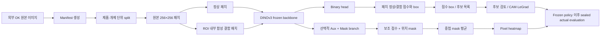

# 기술 가이드

> 프로젝트 개요는 저장소 루트의 [README](../README.md)를 참고하세요. 이 문서는 기존 README의 전체 기술 내용을 그대로 옮긴 상세 가이드입니다.

다품종 산업 부품의 외관 결함을 **원본 해상도 패치 단위**로 검사하기 위한 연구·PoC 모델 코드입니다.
원본 전체를 작은 입력으로 축소하지 않고, 원본 좌표에서 `256×256` 영역을 잘라 각 패치가 정상인지 결함인지 분류합니다.
제품 종류, 촬영 각도, 초점 위치와 정상 구조가 다양해 전체 이미지를 하나의 정상 분포로 처리하기 어려웠던 문제를 줄이는 것이 목적입니다.

## Project Snapshot

- Domain: 다품종 부품 외관 검사 (백점·흑점·균열·chipping 등 미세 결함)
- Problem: 수천만 화소 원본을 축소하면 미세 결함이 사라지고, 전체 이미지 이상탐지는 홀·림·핀·각인·반사 같은 정상 구조에 과반응
- Approach: frozen DINOv3 ViT + 경량 Binary head로 native 패치 분류, OK 이미지 ROI 내부 **합성 결함**으로 학습, 실제 NG는 정책 고정 후 **sealed evaluation**에서만 사용
- Explainability: 패치 점수 heatmap, gradient×token CAM, attention-gradient 기반 LeGrad overlay
- Engineering: manifest·split·config·checkpoint digest를 남기는 run receipt, group-safe split, 대용량 파일·secret 파일명을 막는 저장소 안전 검사, 단위·계약 테스트
- Scope: 모델 연구 코드만 포함. 운영 대시보드, 배포 코드, 원본 이미지, 학습 데이터, backbone weight, checkpoint는 포함하지 않음

> **상태 메모**
>
> - 최종 운영 모델이나 배포 패키지가 아닙니다. `Canonical`은 현재 코드 기준선이라는 뜻이며 성능 인증이 아닙니다.
> - 실제 NG 데이터는 학습이나 threshold 조정에 사용하지 않고, 정책을 고정한 뒤 별도의 sealed evaluation에서만 사용한다는 계약을 따릅니다.
> - 기록된 과거 실험 결과는 당시 데이터·환경의 진단 스냅샷이며 현재 성능을 보증하지 않습니다.

## 문서 읽는 법

이 문서는 비개발자용 개요와 개발자용 실행 절차를 한 문서에 함께 담습니다. 처음 읽는 경우에는 1~8절에서 목적과 구조를 확인하고, 실제 실행자는 9~19절의 환경·명령·제한을 확인하세요. 용어가 낯설면 [용어 정리](#20-용어-정리)를 먼저 참고할 수 있습니다.

| 이 문서의 표현 | 의미 |
| --- | --- |
| 기준 코드(Canonical) | 현재 유지하는 코드 기준선. 성능 인증이나 운영 승인이 아님 |
| Manifest | 이미지 경로, 제품, 개체, 촬영 조건과 split을 기록한 목록 |
| 실행 증빙(receipt) | 입력·설정·코드·출력 digest와 실행 상태를 기록한 파일 |
| 고정 정책(frozen policy) | 실제 NG를 열기 전에 설정과 hash를 고정한 평가 정책 |
| 봉인 평가(sealed evaluation) | 고정 정책을 실제 NG에 적용하며 재조정을 허용하지 않는 평가 |
| Snapshot | 특정 시점의 source를 그대로 보존한 사본. 현재 상태나 품질을 자동 보증하지 않음 |

## 1. 프로젝트 한눈에 보기

| 항목 | 현재 기준 |
| --- | --- |
| 저장소 목적 | 다품종 전 제품 적용을 목표로 한 패치 기반 외관 QC 연구 코드 보존 |
| Python package | `patch-qc-poc` `0.1.0` |
| Python 선언 범위 | `>=3.10` |
| 기준 코드 | `src/patch_qc` |
| 기본 입력 단위 | 원본 이미지에서 자른 RGB `256×256` 패치 |
| 기본 full-image stride | `128` |
| 기본 분류 | 정상 / 결함 Binary 분류 |
| Backbone | 설정상 DINOv3 ViT, 실행 환경에 미리 준비된 weight 사용 |
| 기본 학습 방식 | frozen backbone + 학습 가능한 경량 Binary head |
| 선택 학습 방식 | frozen Binary probe + Auxiliary/Mask 멀티태스크 branch |
| 결함 학습 데이터 | OK 이미지에 ROI 내부 합성 결함을 생성 |
| 실제 NG 사용 | frozen policy 이후 sealed evaluation과 사람 검토만 허용 |
| 추론 결과 | 패치 점수, heatmap, LeGrad 또는 review 결과 |
| 운영 판정 | 이 저장소만으로 PASS/FAIL 자동 운영을 승인하지 않음 |
| 대시보드 | 별도 구성 (이 저장소에 미포함) |


## 2. 왜 패치 분류로 접근했는가

초기에는 전체 이미지 기반 이상탐지 방법도 검토했습니다. 그러나 대상 데이터는 제품 형상과 크기가 다양하고, 같은 제품도 회전 각도·바닥면·초점 위치에 따라 정상 패턴이 크게 달라집니다. 이 조건에서는 모델이 실제 미세 결함보다 홀, 림, 핀, 각인, 반사와 같은 정상 구조에 강하게 반응하는 문제가 발생했습니다.

또한 수천만 화소의 원본 이미지를 한 번에 작은 입력으로 축소하면 미세 백점, 흑점, 가는 균열이나 작은 chipping이 사라질 수 있습니다. 이를 피하기 위해 다음과 같이 접근했습니다.

1. 원본 전체를 한 번에 축소하지 않습니다.
2. 원본에서 `256×256` 패치를 자릅니다.
3. 배경을 제거하거나 별도 클래스로 두지 않고 정상 클래스에 포함해 학습합니다.
4. OK 패치와 합성 결함 패치로 정상/결함 Binary 분류를 학습합니다.
5. 전체 이미지에서는 stride `128` sliding window로 패치를 겹쳐 읽습니다.
6. 패치 점수 또는 mask를 원래 좌표에 다시 합쳐 heatmap을 만듭니다.
7. LeGrad와 review export는 사람이 결함 후보 위치를 확인하는 설명 도구로 사용합니다.

이 방식의 목적은 ROI로 판정 영역을 잘라내는 것이 아니라, 다양한 정상 구조를 정상으로 학습하면서 미세 결함을 원본 크기의 패치에서 보존하는 것입니다.

## 3. 전체 처리 파이프라인



### 3.1 학습과 full-image 추론의 차이

학습은 이미지 한 장에서 일부 패치를 샘플링해 진행할 수 있습니다. 반면 full-image 추론은 `256×256`, stride `128`의 sliding window로 전체 이미지를 훑으며, 오른쪽과 아래쪽 경계가 누락되지 않도록 tail window를 추가합니다.

패치 단위 결과는 다음 방식으로 전체 이미지 좌표에 복원됩니다.

- Binary 결과: 각 패치의 결함 확률과 원래 좌표의 box를 반환합니다. Canonical visualizer는 해당 box를 사각형으로 표시하며 Binary 점수를 픽셀 단위 heatmap으로 평균하는 기능은 제공하지 않습니다.
- Mask 결과: 중첩된 픽셀의 mask 확률을 균등 평균합니다.
- Auxiliary gate: 보조 확률이 threshold를 넘은 패치의 mask만 남기며, 중첩 영역의 분모는 전체 패치 수를 유지합니다. 따라서 일부 패치만 gate를 통과하면 값이 희석될 수 있습니다.
- LeGrad: 선택된 결함 후보의 근거 위치를 사람이 확인할 수 있도록 시각화합니다.

## 4. 모델 및 시각화·검토 구성

### 4.1 Binary head

`DinoBinaryClassifier`는 DINOv3 계열 backbone을 고정한 뒤, backbone의 CLS token과 patch token 평균을 이어 붙여 경량 분류 head에 전달합니다.

```text
RGB 256×256
  -> frozen DINOv3 backbone
  -> CLS token + patch-token mean
  -> LayerNorm
  -> Linear
  -> GELU
  -> Dropout
  -> Linear(1)
  -> 정상/결함 logit
```

Backbone은 기본적으로 학습하지 않으며 Binary head만 업데이트합니다. 이 때문에 Binary checkpoint는 전체 backbone 크기보다 훨씬 작을 수 있습니다. 작은 `.pt` 파일이 곧 모델 누락을 뜻하는 것은 아니며, 실행 시 별도의 backbone weight가 필요합니다.

### 4.2 Auxiliary·Mask 멀티태스크 branch

`DinoMaskMultiTaskProbe`는 이미 학습된 Binary probe 전체를 고정하고, DINO patch token과 RGB multi-scale feature를 결합하는 별도 branch를 학습합니다.

| 출력 | 역할 | 학습 신호 |
| --- | --- | --- |
| `baseline_logits` | 기존 Binary 패치 점수 보존 | 사전 학습된 Binary probe, frozen |
| `auxiliary_logits` | 패치 수준의 추가 결함 단서 | 합성 정상/결함 label |
| `mask_logits` | `256×256` 픽셀 위치 후보 | 합성 결함 mask |

Binary가 NG로 예측한 패치만 Aux와 Mask에 들어가는 직렬 구조가 아닙니다. 같은 패치에서 frozen Binary 결과와 학습 가능한 Aux·Mask 결과를 병렬로 계산합니다. 따라서 이 구조는 하나의 입력에 여러 목적을 동시에 학습하는 멀티태스크 구조에 가깝습니다.

### 4.3 LeGrad와 refinement

LeGrad는 모델 head가 아니라 후보 패치 안에서 분류 판단에 영향을 준 위치를 시각화하는 설명 기법입니다. `refinement` 계열은 수동 NG label 없이 OK·합성 신호·normal memory·TTA 안정성 등을 조합해 검토할 이미지를 순위화합니다.

Refinement의 출력 상태는 기본적으로 `REVIEW`입니다. 이 결과를 곧바로 PASS/FAIL 자동 판정으로 해석하지 않습니다.

## 5. 합성 결함과 ROI의 역할

실제 NG를 학습에 사용하지 않기 때문에, OK 패치에 절차적으로 결함을 합성해 supervised 신호를 만듭니다.

현재 합성 family는 다음과 같습니다.

| Family | 의미 |
| --- | --- |
| `spot` | 백점·흑점과 유사한 점형 결함 |
| `discolor` | 꽃구름·변색과 유사한 저주파 얼룩 |
| `scratch` | 선형 scratch·미세 균열 형태 |
| `pollution` | 불규칙 이물·오염 형태 |
| `fiber` | 머리카락·섬유 형태 |
| `chipping` | 점형 또는 파손형 chipping 형태 |

강도는 `subtle`, `medium`, `strong` 세 단계이며, 기본 확률은 각각 40%, 40%, 20%입니다. 이미지의 sharpness를 이용해 합성 blur 정도를 조절하고, 합성 mask 바깥 픽셀은 원본을 유지합니다.

ROI는 **합성 결함을 세라믹 유효 영역 안에 배치하기 위한 전처리 안전장치**입니다.

- ROI 안에서만 양성 합성 결함을 배치합니다.
- 배경, 홀, 림 등의 정상 패치는 정상 데이터로 학습할 수 있습니다.
- 실제 추론 heatmap이나 PASS/FAIL 결과를 ROI로 강제 삭제하지 않습니다.
- Canonical dataset은 ROI가 비어 있으면 crop 단계에서 오류를 발생시킵니다. `empty_roi_normal_only` fallback은 격리된 clean-retrain snapshot에만 있으므로 두 계보를 혼동하지 않습니다.

합성 결함은 학습 신호를 만들기 위한 도구이며 실제 NG 검출률을 대신 증명하지는 않습니다.

## 6. 데이터와 평가 계약

### 6.1 기본 입력 트리

Manifest 생성기는 외부 OK 루트 아래에서 다음과 같은 구조를 탐색합니다.

```text
/abs/QC_Data/OK/
└── <date>/
    └── <product>/
        └── <object-or-lot>/
            └── **/*.<image-extension>
```

실제 데이터는 저장소 밖에 있어야 합니다. `date`, `product`, `object_id`, 촬영 조건과 이미지 경로가 manifest row에 기록되며, 같은 물리 개체로 취급되는 `product::object_id`는 서로 다른 split에 섞이지 않도록 그룹 단위로 분할합니다.

### 6.2 Split 원칙

기본 split 예시는 다음과 같습니다.

```text
train        70%
calibration  15%
holdout      15%
```

같은 개체의 회전·초점·면 조건 이미지가 train과 holdout에 동시에 들어가면 누수가 발생할 수 있으므로, 이미지 한 장이 아니라 `product::object_id` 그룹을 기준으로 split합니다.

### 6.3 실제 NG와 LabelMe

이 저장소의 현재 평가 계약은 다음과 같습니다.

| 데이터 | 허용 | 금지 |
| --- | --- | --- |
| OK | 정상 학습, split, 합성 결함 배경 | 실제 NG 성능의 분모로 자동 간주 |
| 합성 결함 | Binary·Aux·Mask 학습 | 실제 NG 성능의 대체 주장 |
| 실제 NG·LabelMe | frozen policy 이후 sealed evaluation과 사람 검토 | 학습, calibration, threshold tuning, fixture |
| ROI | 합성 위치와 전처리 보조 | 실제 추론 판정 강제 mask |


학습 데이터와 평가 이미지 hash가 겹치지 않고 policy·checkpoint digest가 고정돼야 sealed evaluation으로 해석할 수 있습니다. 다만 현재 `actual_multitask_eval.py`는 평가 입력 hash와 training receipt/checkpoint digest를 확인할 뿐, 학습 이미지 hash와 평가 이미지 hash의 교집합을 자동 검사하지 않습니다. Refinement의 `--training-hashes`도 CLI 수준에서는 선택 인자입니다. 따라서 **현재 구현만으로 누수 방지가 fail-closed로 보장되지 않으며**, 실제 NG를 열기 전에 외부 preflight에서 training hash 목록을 필수로 제공하고 교집합 0을 확인해야 합니다.

### 6.4 학습·평가 이미지 hash 교집합 preflight

다음 예시는 OK 학습 manifest와 실제 평가 JSONL의 이미지 파일을 다시 hash해 교집합을 검사하고, 실행에 사용할 `training_hashes.json`과 별도 preflight receipt를 저장합니다. 두 출력 경로는 저장소 밖의 새 경로여야 합니다.

```bash
export PATCHQC_TRAIN_MANIFEST=/abs/runs/manifest_20260901/manifest.jsonl
export PATCHQC_EVAL_MANIFEST=/abs/eval/actual_manifest.jsonl
export PATCHQC_TRAINING_HASHES=/abs/runs/preflight_20260901/training_hashes.json
export PATCHQC_PREFLIGHT_RECEIPT=/abs/runs/preflight_20260901/disjointness_receipt.json

python - <<'PY'
import hashlib
import json
import os
from pathlib import Path

train_manifest = Path(os.environ["PATCHQC_TRAIN_MANIFEST"])
eval_manifest = Path(os.environ["PATCHQC_EVAL_MANIFEST"])
hashes_output = Path(os.environ["PATCHQC_TRAINING_HASHES"])
receipt_output = Path(os.environ["PATCHQC_PREFLIGHT_RECEIPT"])

if hashes_output.exists() or receipt_output.exists():
    raise FileExistsError("preflight output already exists")

def sha256_file(path: Path) -> str:
    digest = hashlib.sha256()
    with path.open("rb") as handle:
        for chunk in iter(lambda: handle.read(1024 * 1024), b""):
            digest.update(chunk)
    return digest.hexdigest()

training_hashes = set()
with train_manifest.open(encoding="utf-8") as handle:
    for line in handle:
        if not line.strip():
            continue
        row = json.loads(line)
        for image in row["images"]:
            training_hashes.add(sha256_file(Path(image["path"])))

evaluation_hashes = set()
with eval_manifest.open(encoding="utf-8") as handle:
    for line in handle:
        if not line.strip():
            continue
        row = json.loads(line)
        evaluation_hashes.add(sha256_file(Path(row["image_path"])))

collisions = sorted(training_hashes & evaluation_hashes)
training_hashes_payload = (
    json.dumps(sorted(training_hashes), ensure_ascii=False, indent=2) + "\n"
)
receipt = {
    "stage": "training_eval_image_disjointness_preflight",
    "status": "passed" if not collisions else "failed",
    "training_manifest_sha256": sha256_file(train_manifest),
    "evaluation_manifest_sha256": sha256_file(eval_manifest),
    "training_hashes_sha256": hashlib.sha256(
        training_hashes_payload.encode("utf-8")
    ).hexdigest(),
    "training_unique_image_sha256": len(training_hashes),
    "evaluation_unique_image_sha256": len(evaluation_hashes),
    "collision_count": len(collisions),
}

hashes_output.parent.mkdir(parents=True, exist_ok=True)
receipt_output.parent.mkdir(parents=True, exist_ok=True)
hashes_output.write_text(training_hashes_payload, encoding="utf-8")
receipt_output.write_text(
    json.dumps(receipt, ensure_ascii=False, indent=2, sort_keys=True) + "\n",
    encoding="utf-8",
)
print(json.dumps(receipt, ensure_ascii=False, sort_keys=True))
raise SystemExit(1 if collisions else 0)
PY
```

`collision_count=0`, exit 0과 두 출력 파일의 SHA-256을 확인한 뒤에만 실제 NG를 엽니다. Receipt의 `training_hashes_sha256`과 실제 `training_hashes.json` digest가 같은지도 확인합니다. Actual multitask 평가 CLI는 이 receipt를 자동 읽지 않으므로 실행 기록에 수동으로 연결해야 합니다. Refinement sealed evaluation에서는 생성된 `training_hashes.json`을 `--training-hashes` 인자로 반드시 전달하고, 그 invocation·평가 기록에 `training_hashes_sha256`을 함께 보존합니다.

## 7. 저장소 구조

```text
industrial-visual-qc-dinov3/
├── README.md
├── pyproject.toml
├── configs/                 # 기준 설정 및 연구 계약
├── docs/                    # 아키텍처, 데이터 계약, 실험 매트릭스
├── experiments/             # canonical과 분리한 보존 실험 snapshot
├── scripts/                 # code-only 저장소 안전 검사
├── slurm/                   # H100/Slurm 실행 template
├── src/patch_qc/      # canonical Python package
└── tests/                   # canonical 단위·CLI·계약 테스트
```

### 7.1 주요 canonical 모듈

| 경로 | 역할 |
| --- | --- |
| `capture.py`, `manifest.py`, `split.py` | 이미지 탐색, manifest 생성, group-safe split |
| `roi.py` | 합성 위치용 ROI 처리 |
| `synthetic.py` | 여섯 family·세 단계 합성 결함 생성 |
| `dataset.py` | 제품·촬영 조건 균형 패치 sampling |
| `model.py` | DINOv3 Binary와 Aux·Mask 멀티태스크 모델 |
| `train_probe.py`, `train.py` | Binary probe 학습 |
| `train_multitask.py`, `multitask_train.py` | Aux·Mask 멀티태스크 학습 |
| `inference.py` | Binary sliding-window library |
| `actual_multitask_inference.py` | 멀티태스크 full-image map 결합 |
| `actual_multitask_eval.py` | 고정 actual OK/NG 정성 평가 계약 |
| `cam.py` | gradient×token 방식의 기본 CAM |
| `refinement_legrad.py` | attention-gradient 기반 token LeGrad와 review용 overlay |
| `refinement_*.py` | cache, anchor, policy, ranking, review, sealed evaluation |
| `normal_prior_*.py` | normal-prior 연구 코드 |
| `structural_*.py`, `dual_evidence_*.py` | 구조 억제와 결함 보존 연구 코드 |

## 8. 코드 계보와 실험 상태

| 상태 | 코드 위치 | 의미 | 기본 운영 사용 |
| --- | --- | --- | --- |
| Canonical | `src/patch_qc/` | 현재 유지하는 코드 기준선 | 별도 승인 전 연구·평가용 |
| Supported experimental | canonical의 normal-prior, recurrence, structural, dual-evidence 모듈 | 테스트와 함께 보존한 연구 경로 | 기본 threshold·PASS/FAIL 변경 금지 |
| Legacy v1 provenance | `normal_peak_preservation_v1` 관련 config/code | 과거 결과 재현용 | 신규 실행·품질 주장 금지 |
| Preserved isolated | `experiments/dense_normal_reference_ab_20260831/` | H100 Git 미추적 7파일 보존본 | `quality_claims=false` |

실험의 상태와 사용할 수 있는 범위는 [실험 매트릭스](experiment_matrix.md)를 기준으로 확인합니다.

## 9. 사전 요구사항

### 9.1 로컬 코드 검증

- Python `3.10` 이상
- Git
- 가상환경을 생성할 수 있는 Python 환경

로컬 Mac에서는 manifest, 합성 미리보기, 테스트와 정적 검증을 수행할 수 있습니다. CUDA 학습은 NVIDIA GPU 서버에서 진행합니다.

### 9.2 학습과 추론

- scheduler 또는 명시적으로 할당된 NVIDIA GPU
- 실행 프로세스에서 보이는 GPU 1장
- PyTorch와 CUDA가 호환되는 환경
- 미리 캐시된 DINOv3 backbone
- 저장소 밖의 OK 데이터, manifest, checkpoint와 output 경로

기본 config는 `timm` provider와 `vit_large_patch16_dinov3.lvd1689m`을 사용하며 `local_files_only: true`입니다. 네트워크에서 weight를 자동 다운로드할 것으로 가정하지 않습니다. 필요한 backbone이 실행 환경 cache에 없으면 모델 로딩이 실패합니다.

Torch/CUDA build와 backbone 파일 자체는 이 저장소에서 버전·hash까지 고정하지 않습니다. 실제 학습 재현 시에는 container image, CUDA/Torch 버전, backbone ID·digest를 외부 receipt에 함께 남겨야 합니다.

## 10. 설치

```bash
cd '/path/to/industrial-visual-qc-dinov3'

python3 -m venv .venv
source .venv/bin/activate

python -m pip install --upgrade pip
python -m pip install -e '.[dev]'
```

설치되는 주요 dependency는 NumPy, OpenCV headless, Pillow, PyYAML, timm, PyTorch, Transformers와 개발용 pytest입니다.

설치 후 다음 다섯 CLI가 생성됩니다.

```text
patch-qc
patch-qc-train
patch-qc-train-multitask
patch-qc-eval-actual-multitask
patch-qc-refine
```

## 11. 로컬 검증

### 11.1 Canonical 테스트

```bash
python -m pytest -q
python -m compileall -q src tests scripts
python scripts/check_repository_safety.py --root .
```

### 11.2 전체 snapshot 컴파일

```bash
python -m compileall -q \
  src tests scripts \
  experiments/dense_normal_reference_ab_20260831/src
```

### 11.3 검증 기록

2026-09-01 기준 로컬 검증 기록은 다음과 같습니다.

| 범위 | 결과 |
| --- | --- |
| Canonical | `261 passed` (2026-09-01 기록), 공개본 재검증 `270 passed` |
| CLI help smoke | 5/5 성공 |
| Repository-wide compile | 성공 |
| 10 MiB 초과 tracked blob | 0개 |
| 안전 검사에 정의된 secret pattern | 0건 |

이는 코드와 계약 테스트가 통과했다는 의미입니다. 실제 H100 학습, 모델 품질 또는 배포를 증명하지 않습니다.

## 12. 기본 실행 흐름

### 12.1 OK manifest 생성

```bash
patch-qc build-manifest \
  --root /abs/QC_Data/OK \
  --output-dir /abs/runs/manifest_20260901 \
  --start-date 2026-05-01 \
  --seed 17 \
  --ratios 0.70 0.15 0.15
```

주요 출력은 `manifest.jsonl`과 `summary.json`입니다. 생성 명령 자체는 누락 파일 보고서, split 교집합 감사 또는 manifest digest를 별도 산출하지 않습니다. 아래 후속 검사를 실행자가 수행하고 결과를 외부 실행 기록에 남깁니다.

```bash
export PATCHQC_MANIFEST=/abs/runs/manifest_20260901/manifest.jsonl

python - <<'PY'
from collections import defaultdict
import hashlib
import json
import os
from pathlib import Path

manifest = Path(os.environ["PATCHQC_MANIFEST"])
groups = defaultdict(set)
missing = []

with manifest.open(encoding="utf-8") as handle:
    for line_number, line in enumerate(handle, 1):
        if not line.strip():
            continue
        row = json.loads(line)
        groups[row["group_id"]].add(row["split"])
        for image in row["images"]:
            if not Path(image["path"]).is_file():
                missing.append((line_number, image["path"]))

leaked = {group: sorted(splits) for group, splits in groups.items() if len(splits) > 1}
print(f"manifest_sha256={hashlib.sha256(manifest.read_bytes()).hexdigest()}")
print(f"missing_images={len(missing)}")
print(f"cross_split_groups={len(leaked)}")
raise SystemExit(1 if missing or leaked else 0)
PY
```

제품·촬영 조건별 분포는 `summary.json`과 manifest를 함께 확인합니다. Canonical Binary 학습 CLI는 `run_receipt.json`을 만들지 않으므로 manifest digest를 자동으로 training receipt에 연결해 주지 않습니다.

### 12.2 합성 결함 미리보기

```bash
patch-qc make-synthetic-preview \
  --image /abs/QC_Data/OK/sample.jpg \
  --output-dir /abs/runs/synthetic_preview \
  --patch-size 256 \
  --seed 17
```

각 family와 severity 조합의 미리보기, 위치 표시 패널과 `summary.json`이 생성됩니다. 학습을 시작하기 전에 실제 제품 구조 위에서 결함의 크기, 대비, blur, 색과 ROI 배치가 자연스러운지 사람이 확인합니다.

### 12.3 Binary probe 학습

저장소의 기준 config를 외부 실행 디렉터리에 복사하고 데이터 경로, backbone과 학습 자원을 환경에 맞게 수정합니다.

```bash
mkdir -p /abs/run-configs
cp configs/poc.yaml /abs/run-configs/poc.yaml

export PATCHQC_BINARY_RUN=/abs/runs/binary_probe_20260901_001
test ! -e "$PATCHQC_BINARY_RUN" || { echo "output already exists" >&2; exit 1; }

CUDA_VISIBLE_DEVICES=0 patch-qc-train \
  --config /abs/run-configs/poc.yaml \
  --manifest /abs/runs/manifest_20260901/manifest.jsonl \
  --output-dir "$PATCHQC_BINARY_RUN"

cp /abs/run-configs/poc.yaml "$PATCHQC_BINARY_RUN/config_used.yaml"
sha256sum \
  /abs/runs/manifest_20260901/manifest.jsonl \
  "$PATCHQC_BINARY_RUN/config_used.yaml" \
  "$PATCHQC_BINARY_RUN"/head_epoch_*.pt \
  > "$PATCHQC_BINARY_RUN/input_and_checkpoint_sha256.txt"
```

Binary 학습 CLI는 정확히 한 장의 visible GPU를 요구합니다. 주요 출력은 `metrics.jsonl`과 `head_epoch_NNN.pt`입니다. Binary checkpoint에는 backbone 전체가 아니라 backbone 식별정보와 학습된 head가 저장되므로 backbone보다 파일이 작은 것이 정상입니다.

Canonical Binary 학습은 resolved config, `run_receipt.json`, manifest·config·code·runtime digest를 자동 생성하지 않습니다. 같은 output 경로를 재사용하면 metrics가 이어 붙고 동일 epoch checkpoint가 덮어써질 수 있으므로 매 실행마다 존재하지 않는 새 경로를 사용하고, 사용한 config와 SHA-256 목록을 외부 증빙으로 별도 보존합니다. Binary run은 이 보강 증빙 없이는 sealed 또는 완전 재현 가능한 실행으로 간주하지 않습니다.

Binary holdout은 합성 결함 기반이며 실제 NG 성능이 아닙니다. `configs/poc.yaml`의 `calibration.target_patch_fpr`는 현재 설정 필드로 존재하지만 운영 threshold calibration이 구현·승인됐다는 뜻은 아닙니다.

### 12.4 Aux·Mask 멀티태스크 학습

```bash
cp configs/synthetic_mask_multitask_smoke.yaml \
  /abs/run-configs/multitask.yaml

export PATCHQC_BINARY_RUN=/abs/runs/binary_probe_20260901_001

CUDA_VISIBLE_DEVICES=0 patch-qc-train-multitask \
  --config /abs/run-configs/multitask.yaml \
  --manifest /abs/runs/manifest_20260901/manifest.jsonl \
  --base-checkpoint "$PATCHQC_BINARY_RUN/head_epoch_003.pt" \
  --output-dir /abs/runs/multitask
```

멀티태스크 config의 `inputs.expected_manifest_sha256`과 `inputs.expected_base_checkpoint_sha256`은 실제 입력과 일치하도록 외부 복사본에서 명시적으로 고정해야 합니다.

주요 출력은 resolved config, `schedule.jsonl`, epoch checkpoint, `metrics.jsonl`, visualization index와 `run_receipt.json`입니다.

> **주의:** 이 경로는 smoke 성격의 설정입니다. 품질 gate를 충족하지 못해도 디버깅용 checkpoint와 metrics를 남기고 exit 0일 수 있습니다. 종료 코드만 보지 말고 receipt의 `status`·`quality_gate`, metrics와 checkpoint 생성 상태를 함께 확인합니다.

## 13. Full-image 추론과 시각화

### 13.1 Sliding-window library

`src/patch_qc/inference.py`는 Binary 모델용 `256×256`, stride `128` full-image sliding-window library를 제공합니다. 현재 설치 entrypoint에는 범용 production inference CLI가 없습니다.

원본 해상도에서 패치를 생성하고 배치 단위로 GPU에 전달한 뒤 패치 점수를 전체 이미지 좌표로 복원합니다. Stride를 늘리면 속도는 빨라지지만 미세 결함 coverage와 위치가 달라질 수 있으므로, 별도 실제 NG 재검증 없이 `160`이나 `192`로 변경하지 않습니다.

### 13.2 Frozen actual OK/NG 평가

```bash
CUDA_VISIBLE_DEVICES=0 patch-qc-eval-actual-multitask \
  --config /abs/run-configs/multitask.yaml \
  --eval-manifest /abs/eval/actual_manifest.jsonl \
  --base-checkpoint /abs/checkpoints/base.pt \
  --multitask-checkpoint /abs/checkpoints/multitask.pt \
  --training-receipt /abs/runs/multitask/run_receipt.json \
  --expected-eval-manifest-sha256 <EVAL_MANIFEST_SHA256> \
  --expected-training-receipt-sha256 <TRAINING_RECEIPT_SHA256> \
  --expected-multitask-sha256 <MULTITASK_CHECKPOINT_SHA256> \
  --output-dir /abs/runs/actual_eval \
  --batch-size 128
```

출력은 raw/gated heatmap PNG, 원본+overlay 비교 JPG, `predictions.jsonl`과 `run_receipt.json`입니다. LabelMe ground-truth PNG는 해당 row에 `label_path`가 있을 때만 생성됩니다.

이 CLI는 범용 실제 NG 평가기가 아닙니다. 현재 코드는 고정된 actual-evaluation 계약과 이미지 shape, cohort 수, expected digest를 검증합니다. 다른 데이터셋에 적용하려면 별도의 평가 계약과 테스트가 필요합니다.

### 13.3 Raw-primary 비교 export

```bash
python -m patch_qc.raw_primary_export \
  --source-run /abs/runs/actual_eval \
  --output-dir /abs/runs/raw_primary_export \
  --expected-source-receipt-sha256 <SOURCE_RECEIPT_SHA256>
```

Source receipt, predictions, 원본과 raw heatmap hash를 검증한 뒤 원본+raw-map 비교 JPG와 새 receipt를 생성합니다. 이 모듈은 설치형 CLI가 아니라 Python module 실행 방식입니다.

## 14. Label-free refinement 흐름

Refinement는 한 번에 실행되는 단일 명령이 아니라 다음 단계로 구성됩니다.

| 순서 | 명령 | 역할 |
| ---: | --- | --- |
| 1 | `patch-qc-refine build-cache` | OK manifest에서 후보 점수·embedding cache 생성 |
| 2 | `patch-qc-refine merge-cache` | shard cache를 사용한 경우 안전 병합 |
| 3 | `patch-qc-refine build-anchors` | clean·synthetic anchor와 normal memory 생성 |
| 4 | `patch-qc-refine fit-refiner` | deterministic fusion 또는 weak ranker 적합 |
| 5 | `patch-qc-refine freeze-policy` | upstream receipt와 digest 검증 후 정책 고정 |
| 6 | `patch-qc-refine rank-images` | label 없는 실제 이미지에서 REVIEW 후보 순위화 |
| 7 | `patch-qc-refine sealed-evaluate` | frozen policy를 실제 NG/LabelMe로 한 번 평가 |
| 8 | `patch-qc-refine export-review` | 원본·LeGrad·comparison·metadata export |

전체 인자는 현재 코드의 도움말을 기준으로 확인합니다.

```bash
patch-qc-refine build-cache --help
patch-qc-refine merge-cache --help
patch-qc-refine build-anchors --help
patch-qc-refine fit-refiner --help
patch-qc-refine freeze-policy --help
patch-qc-refine rank-images --help
patch-qc-refine sealed-evaluate --help
patch-qc-refine export-review --help
```

Refinement 사용 시 `manual_labels: 0`, `real_ng_usage: sealed_evaluation_only`, `review_state: REVIEW` 계약을 유지합니다. 현재 CLI에서 `--training-hashes`는 생략 가능하지만 실제 sealed evaluation에서는 필수 입력으로 취급하고, 평가 manifest와의 hash 교집합 0을 별도 preflight에서 확인합니다.

> **주의:** 봉인 평가를 연 뒤에는 같은 결과를 보고 정책이나 threshold를 다시 조정하지 않습니다. 조정이 필요하면 해당 결과를 개발 데이터로 재분류하고 새로운 미사용 평가셋을 별도로 마련해야 합니다.

## 15. Slurm 실행

`slurm/`에는 H100 실행을 위한 launcher 예시가 있습니다. 이 파일은 portable script가 아니라 job contract를 보여주는 template이며, `/path/to/...` 경로와 checkpoint는 환경에 맞게 바꿔야 합니다.

제출 전 다음 항목을 확인합니다.

- 현재 scheduler queue와 본인 GPU 할당
- 절대 project/data/output 경로
- 프로세스에서 보이는 GPU 수
- backbone cache 존재 여부
- manifest·checkpoint·receipt SHA-256
- 기존 output을 덮어쓰지 않는 새 출력 경로
- 다른 사용자의 job이나 GPU를 변경하지 않았는지


## 16. 출력과 재현성 규칙

모든 runtime artifact는 저장소 밖의 절대 경로에 기록합니다. 아래 구조는 멀티태스크·refinement 계열의 권장 형태이며, Canonical Binary 학습은 resolved config와 receipt를 자동 생성하지 않는다는 예외가 있습니다.

```text
/abs/runs/<run-id>/
├── resolved_config.*
├── metrics.jsonl
├── schedule.jsonl
├── *.pt
├── visualizations/
└── run_receipt.json
```

재현 가능한 실행을 위해 다음을 기록합니다.

- source commit 또는 실행 코드 digest
- resolved config
- manifest·checkpoint·backbone SHA-256
- container image와 Python·Torch·CUDA 버전
- seed, patch size, stride, batch size와 precision
- GPU 모델과 프로세스에서 보인 GPU 수
- 시작·완료 시각과 종료 상태
- 실패 수와 임시 파일 잔존 여부
- output artifact 목록과 SHA-256

| Snapshot | Manifest | 파일 수 |
| --- | --- | ---: |
| Dense normal | `experiments/dense_normal_reference_ab_20260831/SOURCE_SHA256SUMS` | 7 |

Manifest는 캡처 당시 source byte를 증명하지만 원본 H100/local 경로가 이후에도 바뀌지 않았음을 보증하지는 않습니다.

## 17. Git에 포함하지 않는 파일

다음 파일은 Git에 추가하지 않습니다.

- OK/NG 원본 이미지와 LabelMe
- manifest, patch image와 tar cache
- checkpoint와 DINOv3 backbone
- ONNX, TensorRT engine 등 모델 binary
- output, heatmap, comparison, log와 result
- runtime receipt와 임시 receipt
- `.env`와 secret·password·token·credential처럼 보이는 파일명
- 10 MiB를 초과하는 runtime 파일

`scripts/check_repository_safety.py`는 파일 생성을 사전에 막는 도구가 아닙니다. 현재 작업 트리에서 금지 경로·확장자, secret처럼 보이는 **파일명**, 대용량 파일을 발견하면 실패하도록 하는 검사 gate입니다. 파일 내용에 포함된 token이나 password를 읽어 검사하지는 않습니다.

```bash
python scripts/check_repository_safety.py --root .
```

검사 결과가 0이어도 `git status`, tracked tree, blob 크기 검사와 별도의 tracked 파일 내용 secret scan을 함께 확인합니다.

## 18. 알려진 제한과 주의사항

### 18.1 커밋 전 안전 검증

`.gitignore`와 저장소 안전 검사는 `run_receipt.json`과 `run-receipt.json`처럼 `_`·`-` 구분자를 쓰는 runtime receipt를 모두 차단합니다. 단수·복수, JSON·JSONL, `.tmp`·`.part`·`.attempt` 변형은 회귀 테스트로 검증하며, `receipt_schema.json`은 소스 스키마로 계속 허용합니다.

커밋 전에는 로컬 전체 테스트, compile, 저장소 안전 검사(`scripts/check_repository_safety.py`)를 실행합니다.

### 18.2 모델·평가 제한

- 모델 backbone과 checkpoint가 저장소에 없어 clone만으로 학습·추론을 재현할 수 없습니다.
- 범용 production inference CLI가 없습니다.
- Binary holdout은 합성 결함 기반이며 실제 NG 성능이 아닙니다.
- Canonical Binary 학습은 resolved config·run receipt·입력 digest를 자동 기록하지 않고 output 재사용도 차단하지 않습니다.
- Actual multitask evaluation은 고정 cohort·shape·digest 계약에 묶여 있습니다.
- Actual multitask evaluation은 학습 이미지 hash와 평가 이미지 hash의 교집합을 자동 검사하지 않습니다.
- Refinement sealed evaluation의 `--training-hashes`는 CLI에서 선택 인자이므로 운영 절차에서 별도로 필수화해야 합니다.
- 역사적 actual NG 비교에는 정책 선택에 반복 사용된 개발 진단 결과가 포함되어 unseen sealed test로 볼 수 없습니다.
- LeGrad와 heatmap은 설명·검토 도구이며 정확한 segmentation ground truth를 보장하지 않습니다.
- 표시 threshold와 PASS/FAIL 판정 threshold는 별도 계약으로 관리해야 합니다.

### 18.3 코드 계보 제한

- `normal_prior_postprocess.py`의 sparse SIFT fallback에는 `knnMatch(k=2)` 결과가 한 개뿐일 때 `ValueError`가 날 수 있는 알려진 문제가 있습니다.
- `normal_peak_preservation_v1`은 config에 기록된 reference-shard receipt hash를 실행 시 강제하지 않아 신규 품질 주장에 사용할 수 없습니다.
- Structural/dual-evidence evaluator receipt의 `code.dirty: true`는 실제 Git 상태 측정값이 아니라 보수적으로 고정된 metadata입니다.
- Canonical refinement shard 분배는 절대 path digest에 의존하는 경로가 있어 mount alias가 바뀌면 동일 논리 데이터의 shard가 달라질 수 있습니다.
- Dense-normal snapshot의 smoke 기록은 `quality_claims=false`이며 committed runtime receipt가 없습니다.

### 18.4 성능 수치 해석

과거 문서의 검출 수, OK 억제율, GPU 처리 시간은 당시 제한된 데이터와 환경의 진단 결과입니다. 현재 모델 성능, 전 제품 일반화, 고객사 운영 latency 또는 배포 승인을 보증하지 않습니다. 숫자를 인용할 때는 데이터 분모, dataset 역할, checkpoint·policy digest, patch/stride, precision과 측정 환경을 함께 적습니다.

## 19. 문서 인덱스

| 문서 | 내용 |
| --- | --- |
| [아키텍처](architecture.md) | 코드 계층과 canonical/isolated 경계 |
| [데이터 계약](data_contract.md) | OK·합성·실제 NG·ROI 사용 원칙 |
| [실험 매트릭스](experiment_matrix.md) | 각 방법론의 상태와 운영 사용 여부 |
| [실험 실행 제한](../experiments/README.md) | normal-prior·v1·receipt 관련 known limitation |


## 20. 용어 정리

| 용어 | 의미 |
| --- | --- |
| Patch | 원본에서 자른 `256×256` RGB 입력 단위 |
| Stride | 다음 patch 시작점까지의 이동 간격 |
| Binary head | patch를 정상/결함으로 분류하는 경량 head |
| Auxiliary head | 멀티태스크 branch의 보조 patch-level 점수 |
| Mask head | 합성 결함 위치를 학습하는 pixel-level 출력 |
| ROI | 합성 결함 위치를 제한하는 전처리 mask |
| LeGrad | 후보 patch의 분류 근거를 보여주는 설명용 heatmap |
| Calibration | 정책을 고정하기 전 threshold·통계 기준을 정하는 단계 |
| Frozen policy | 실제 NG를 열기 전에 hash와 설정을 고정한 평가 정책 |
| Sealed evaluation | frozen policy를 실제 NG에 한 번 적용하는 평가 |
| Receipt | 입력·설정·코드·출력 digest와 실행 상태를 기록한 영수증 |
| REVIEW | 자동 PASS/FAIL이 아니라 사람이 확인해야 하는 상태 |
| Backbone | 이미지 특징을 추출하는 사전학습 기반 모델. 이 저장소에는 weight가 없음 |
| Manifest | 이미지 경로와 제품·개체·촬영 조건·split을 기록한 목록 |
| Split | 데이터를 train·holdout·calibration 등 서로 다른 역할로 나누는 것 |
| 데이터 누수 | 같은 개체나 평가 정보가 학습·조정 단계에 섞여 성능이 부풀려지는 문제 |
| Normal memory | 정상 패치 특징을 비교하기 위해 저장한 기준 feature 집합 |
| TTA | 밝기·이동 등 입력 변형에서 예측이 안정적인지 확인하는 방법 |
| Fixture | 테스트 코드가 반복 검증에 사용하는 고정 입력 데이터 |
